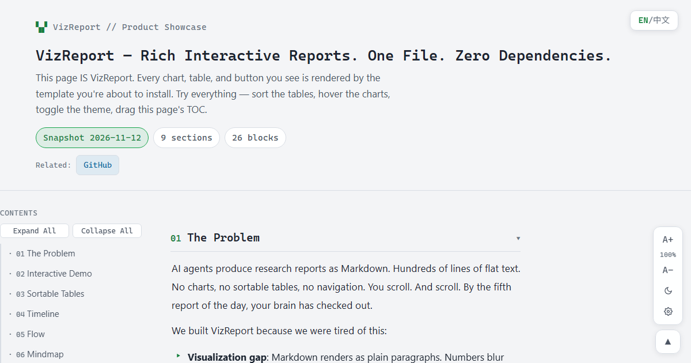
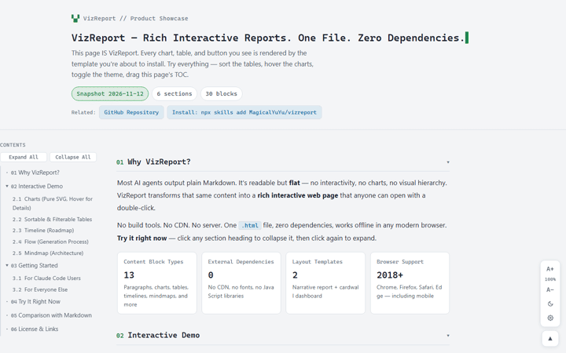
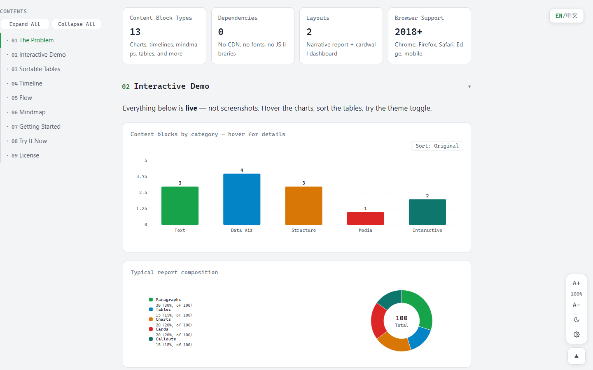

<p align="center">
  
</p>

<h1 align="center">VizReport</h1>

<p align="center"><strong>Rich interactive reports. One file. Zero dependencies.</strong></p>

<p align="center"><sub><a href="README.zh-CN.md">中文文档</a> · <a href="https://magicalyuyu.github.io/vizreport/">Live Demo</a></sub></p>

---

## The Problem

AI agents produce research reports as Markdown. Hundreds of lines of flat text. No charts. No sortable tables. No navigation. You just scroll. And scroll. By the fifth report of the day, your brain has checked out.

We built VizReport because we were tired of this:

- **Visualization gap**: Markdown renders as plain paragraphs. Numbers blur together. Trends are invisible without charts.
- **Interaction gap**: You cannot sort a Markdown table. You cannot filter by a tag. You cannot collapse a section you don't need. You cannot adjust text size.
- **Sharing friction**: Send a `.md` file and they need to install a renderer. Send a VizReport — everyone has a browser, right? — and they just double-click. That's it.

## The Solution

VizReport is an agent skill that transforms the same content into a **self-contained interactive HTML file**:

- Charts rendered as pure SVG with hover tooltips (no CDN, works offline)
- Tables with three-state sorting, keyword filtering, and per-column value filters
- A sticky table of contents with collapsible sections
- Light and dark themes with persistent preferences
- Adjustable content width and five-step font sizing
- All in one `.html` file, approximately 50-80 KB

The report you are reading right now ([Live Demo](https://magicalyuyu.github.io/vizreport/)) is a VizReport file. Every feature described here can be tested on that page.

## What It Looks Like





## Quick Start

Install as a Claude Code skill:

```bash
npx skills add MagicalYuYu/vizreport
```

Then ask your agent:

> Turn this research into a visual report

The skill selects the appropriate layout (narrative report or cardwall dashboard), generates the data, and produces a single HTML file.

No agent? Download a template from `templates/`, edit the JSON data island, and open in a browser.

## Content Blocks

VizReport supports thirteen content block types:

| Category | Blocks |
|----------|--------|
| Text | Heading (2 levels), paragraph (bold, code, links), bullet list, quote |
| Data | Stat cards, charts (bar, horizontal bar, line, donut), tables |
| Visual | Timeline, process flow, concept map (mindmap) |
| Media | Images with captions, highlighted callouts |

All charts are rendered as inline SVG with zero external dependencies. All tables support sorting and filtering out of the box.

## Comparison with Plain Markdown

| Aspect | Markdown | VizReport |
|--------|----------|-----------|
| Charts | Not supported natively | Interactive SVG with hover details |
| Tables | Static, no sorting | Three-state sort plus row and column filtering |
| Navigation | Linear scrolling only | Sticky TOC with collapsible sections |
| Themes | Reader-dependent | Light and dark toggle, saved across visits |
| Text sizing | Reader-dependent | Built-in five-step control |
| Sharing | Requires a Markdown renderer | Double-click any HTML file |
| Offline | Depends on viewer | Zero network requests |

## Browser Compatibility

Chrome, Firefox, Safari, and Edge (2018 and later). Mobile responsive. Works fully offline.

## Architecture

```
+-------------------------------------------+
|            Single HTML File               |
+-------------------------------------------+
|  <script id="aos-data">                   |
|    { meta, blocks: [...] }  <- Your data  |
|  </script>                                |
|  <style> CSS tokens + themes </style>    |
|  <script> Renderer (vanilla JS) </script>|
+-------------------------------------------+
        No build step. No CDN. No server.
```

## Report Index

Generate a searchable index page for all your reports:

```bash
python scripts/build_index.py
```

Produces a self-contained `showcase-index.html` with card, list, and detail views. Search, pin, hide, and iframe preview are built in.

## License

MIT
