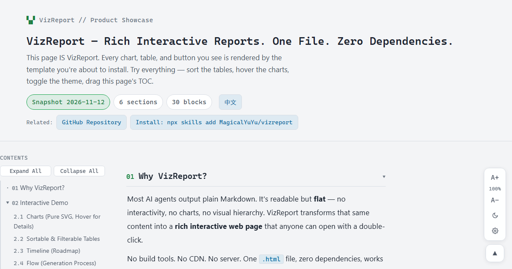
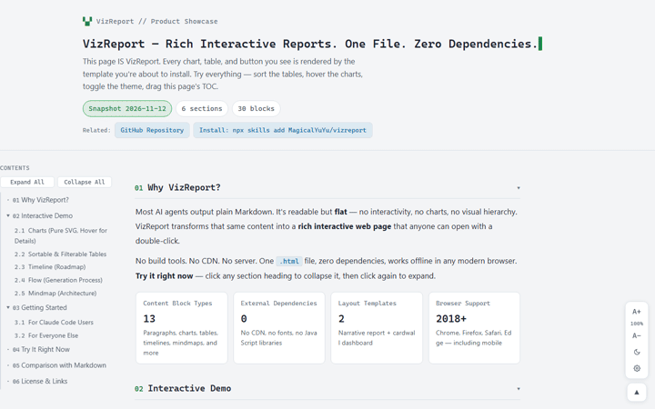
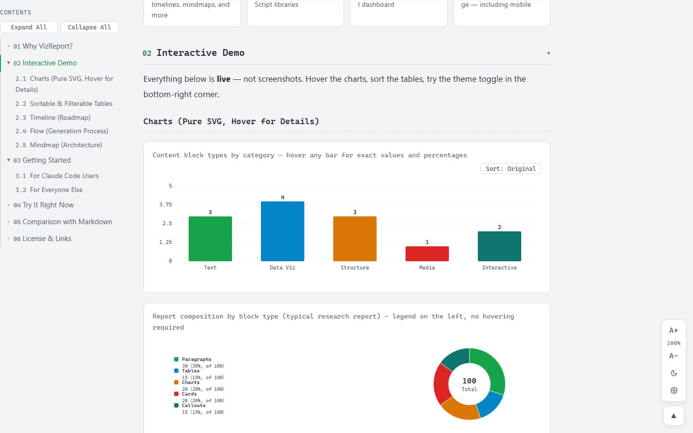

<p align="center">
  
</p>

<h1 align="center">VizReport</h1>

<p align="center"><strong>富交互报告。单文件。零依赖。</strong></p>

<p align="center"><sub><a href="README.md">English</a> · <a href="https://magicalyuyu.github.io/vizreport/">在线演示</a></sub></p>

---

## 为什么需要 VizReport？

AI Agent 产出的调研报告通常是 Markdown——大段纯文本，读到第五份时眼睛已经花了。

- **可视化差距**：Markdown 只能渲染纯文本段落，数字混作一团，趋势不可见
- **交互差距**：不能排序、不能筛选、不能折叠不需要的章节、不能调整字号
- **分享摩擦**：发送 `.md` 文件对方需要渲染器；发送 VizReport 对方双击就能打开

## 效果





## 快速开始

```bash
npx skills add MagicalYuYu/vizreport
```

然后对 Agent 说「把这次调研做成可视化报告」。

也可以手动使用：下载 `templates/` 里的模板，修改 JSON 数据岛，浏览器打开。

## 内容块类型

VizReport 支持十三种内容块：

| 类别 | 内容块 |
|------|--------|
| 文本 | 标题（两级）、段落（加粗/代码/链接）、列表、引文 |
| 数据 | 统计卡、图表（柱状/条形/折线/圆环）、表格 |
| 视觉 | 时间线、流程图、思维导图 |
| 媒体 | 图片（带图注）、提示框 |

所有图表为内联 SVG，零外部依赖。所有表格开箱即用支持排序和筛选。

## 与 Markdown 的区别

| 方面 | Markdown | VizReport |
|------|----------|-----------|
| 图表 | 原生不支持 | 交互式 SVG，悬停显示详情 |
| 表格 | 静态，不可排序 | 三态排序 + 行筛选 + 列筛选 |
| 导航 | 只能滚动 | 粘滞目录 + 可折叠章节 |
| 主题 | 依赖阅读器 | 亮色/暗色切换，跨文件记忆 |
| 字号 | 依赖阅读器 | 内置五档调节 |
| 分享 | 需要 Markdown 渲染器 | 双击任何 HTML 文件 |
| 离线 | 取决于查看器 | 零网络请求 |

## 浏览器兼容

Chrome、Firefox、Safari、Edge（2018 年及以后）。手机自适应。完全离线可用。

## 许可

MIT
